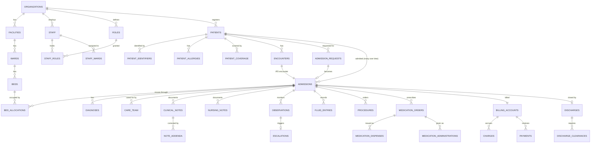

# EDOSHMIS — architecture, database plan and roadmap

EDOSHMIS (EDOS Hospital Management Information System), by EDOS Centre Ltd.
*Smarter Hospital Operations. Better Patient Care.*

This document records what was found in `edos_db`, the decisions taken from it, what is built and tested, and what comes next.

---

## 1. What was found (Phase 1 discovery, 2026-11-03)

**The database.** `edos_db` is the Supabase project with ref `kqpltwrhzbjfyxkttwzh`; EDOS Lend, EDOS LMIS and the appointment-booking system already connect to it. (EDOS Poa, Hatch360, PMIS and CRM use a *different* project and are not touched.) A read-only scan of its schema found **375 tables and views** across many products:

| Prefix | Product | Tables |
|---|---|---|
| `edos_` | EDOS Lend | 85 |
| `edoslmis_` | EDOS LMIS (laboratory) | 67 |
| `edoshms_` | **An earlier hospital product** | 51 |
| `edoshatch360_` | Hatch360 | 40 |
| `appbookings_` | Appointment booking | 19 |
| `crane_`, `farm_`, unprefixed | Crane, poultry, legacy POS and clinic | ~110 |

**No `edoshmis_` object existed.** The namespace was free.

**An earlier hospital system already lives here** under the prefix `edoshms_` (one letter shorter). It has 51 tables (patients, visits, admissions, wards, beds, prescriptions, invoices, SHA claims, chart of accounts) and **live data**: 3 tenants and 20 user profiles. No source code for it was found among the projects, and **EDOS LMIS depends on its identity tables** (`edoshms_tenants`, `edoshms_user_profiles`, `edoshms_roles`).

**Collision risk.** The older product created its enum types **without a prefix** in `public`, for example `public.admission_status`, `public.bed_status`, `public.gender` and `public.payment_method`. A new schema that reused those names would fail, or silently share them.

### Decisions taken from that

1. **EDOSHMIS is fully independent.** The brief requires its own namespace and forbids reusing another product's tables "even if their structures appear similar". It therefore has its own organisations, staff, roles and patients, and touches nothing in `edoshms_`, `edoslmis_` or anywhere else.
2. **Every object is prefixed `edoshmis_`.** That covers tables, enum types, functions, triggers, policies and indexes. No unprefixed type is created, so nothing can collide with `public.admission_status` and the like.
3. **Sign-ins are shared, data is not.** Supabase Auth (`auth.users`) is one per project, so a nurse who already uses another EDOS app keeps one login. Being in `auth.users` grants nothing in EDOSHMIS; only an active `edoshmis_staff` row with a role does.
4. **The old `edoshms_` product is left exactly as it is.** Whether its three tenants should ever be migrated into EDOSHMIS is a business decision for EDOS Centre, and is listed under open questions.

---

## 2. System architecture

```
 Browser (phone / tablet / desktop, PWA-ready)
   │  Next.js 16 App Router — server components render every screen;
   │  forms post to server actions (no client-side data access)
   ▼
 Next.js server (Vercel)
   │  · proxy.ts refreshes the Supabase session on every request
   │  · lib/session.ts: who, which hospital/facility, which permissions (UI only)
   │  · server actions call Postgres as the signed-in user (anon key + JWT)
   │  · service-role key used ONLY for Supabase Auth Admin (creating a login),
   │    after the caller's admin.staff permission is checked in the database
   ▼
 Supabase edos_db (Postgres 17)
   · edoshmis_* tables, all with RLS            ← the read boundary
   · edoshmis_* SECURITY DEFINER functions       ← every multi-row workflow,
     (admit, transfer, prescribe, discharge…)      permission-checked inside,
                                                   one transaction each
   · triggers: author stamping, signed-note freeze, append-only guards,
     early-warning scoring, audit log
```

**Why the database decides.** Clinical rules have to hold whoever calls: the UI, a script, or a future mobile app. "A bed cannot hold two patients", "a signed note cannot change", "a dose cannot be given before pharmacy verifies it" and "a discharge cannot complete before billing clears" are therefore enforced in Postgres by functions, triggers, unique indexes and RLS. The Next.js code only displays what the database says. When the database refuses something, its message is written for the person at the bedside and shown to them as written.

**Stack.** Next.js 16.3 (App Router, server actions), React 19, TypeScript, Tailwind CSS 4, Lucide icons, Supabase (Postgres, Auth, RLS), zod for form validation, and Vitest with PGlite (an in-process Postgres 17) for database tests.

---

## 3. Module breakdown

Status key: **Built** = working end to end and covered by database tests. **Schema** = tables exist, UI to come. **Planned** = designed, not yet built.

| Module | Status | What exists |
|---|---|---|
| **Foundation**: organisations, facilities, departments, staff, roles, permissions, audit | **Built** | Multi-facility organisations. 40 permission keys and 13 starter roles, editable per hospital. Staff onboarding reuses an existing EDOS login. Append-only audit log, record-access log and sign-in log. |
| **Patient registration & records** | **Built** | Hospital numbers per facility code. Kenyan IDs: national ID, passport, birth certificate, alien ID, SHA number. Next of kin, emergency contacts, guardians. Duplicate detection with configurable rules and an override reason that is audited. Recorded Data Protection Act consent. Allergies, including an explicit "no known allergies" status. History and alerts. SHA and insurance cover with manual verification. |
| **IPD — admission** | **Built** | Request from OPD, emergency, theatre, referral, direct or transfer in; clinical approval or rejection with a reason; bed allocation; ward handover; encounter, admission and billing account opened in one transaction. |
| **IPD — wards & beds** | **Built** | 15 ward types. Sex-restricted wards and beds. Isolation beds. A visual bed board with the states available, occupied, reserved, cleaning, maintenance and blocked. Reservations that expire. Full bed event history. Double allocation is impossible: a row lock plus two partial unique indexes. |
| **IPD — patient workspace** | **Built** | A banner with ward and bed, length of stay, consultant, diagnosis, allergies and alerts, plus tabs: Overview, Clinical notes, Nursing, Observations, Diagnosis, Medication · eMAR, Fluid balance, Procedures, Billing, Discharge, History. |
| **Doctor's rounds** | **Built** | SOAP notes with type, findings, assessment and plan, discharge readiness and specialist requests. A note is signed or kept as a draft; once signed it is frozen by the database and corrected only by signed addenda. |
| **Nursing** | **Built** | Notes by shift with 13 categories (handover, wound care, fall risk, pressure injury, pain and others). Named assessment tool and score. Care plans with goal, interventions and evaluation. Nursing notes are final when written; corrections are addenda. |
| **Observations & early warning** | **Built** | Temperature, pulse, RR, BP, SpO₂ with supplemental O₂, AVPU, pain, glucose, weight, height, BMI. Charted as small multiples. Scoring and escalation come only from bands and rules the facility enters and a named clinician approves. With no bands configured there is no score, and the screen says so. Escalations are acknowledged, then resolved with an outcome. |
| **Medication & eMAR** | **Built** | Prescribe, then pharmacy verify or reject, then dispense, then administer, as distinct acts by distinct permissions. Allergy check against the drug, brand and class. Interaction check against pairs the pharmacy enters, each with a cited source. Overrides need a reason. Scheduled doses are laid out by the due times; PRN doses have a maximum per 24 hours. Statuses: given, delayed, missed, refused, withheld, discontinued. Controlled drugs need a second-person witness. A recorded dose is frozen. |
| **Fluid balance** | **Built** | Intake (oral, IV, enteral, blood) and output (urine, drain, vomitus, stool, aspirate) with per-shift and 24-hour (07:00–07:00) balances. Entered-in-error instead of edits. |
| **Procedures** | **Built** | Requested, authorised, scheduled, then done or cancelled. Consent is required before "done". Notes, outcome, complications, monitoring and follow-up. |
| **Discharge** | **Built** | Routine, against medical advice, transfer out, death or absconded. Summary (needs a final diagnosis), medication reconciliation, investigations review, then billing, pharmacy and nursing clearances, then authorisation. Only authorisation releases the bed, closes the admission, the encounter and the bill, and lapses outstanding doses. Printable discharge summary. |
| **Inpatient billing** | **Built** | One account per admission. Bed-days charged once per Nairobi calendar day from the bed's or ward's tariff, idempotently. Manual charges from tariffs, with SHA prices where set. Dispensing charges automatically when the drug has a price. Deposits, payments, insurer settlements, waivers and refunds. An M-Pesa code is accepted once per facility. Discounts and reversals are negative lines with a reason; nothing is ever deleted. |
| **Pharmacy (inpatient)** | **Built** | Queue to verify (showing allergies and overrides), then issue with batch and expiry; expired stock is refused. Drug catalogue and interactions. |
| **Dashboard** | **Built** | Role-aware. Every figure is a live count from `edoshmis_dashboard()` and links to its list: census, beds, occupancy, requests, discharges, ALOS, escalations, prescriptions to verify, overdue doses, outstanding bills, today's collections, patients. Ward occupancy and a 14-day admissions trend. |
| **Administration** | **Built** | Organisation and facilities, departments, wards and beds (bulk add), tariffs, staff and roles (permission matrix), ward assignments, clinical settings (EWS bands, escalation rules, drugs, interactions), audit and access logs. |
| OPD (check-in, triage, queue, consultation) | Planned | Admissions accept `source = opd` and link an encounter. The OPD module itself is Phase 4. |
| Emergency, maternity, paediatrics, theatre, ICU/HDU specifics | Planned | ICU, HDU, maternity and neonatal ward types and observation schemes already exist. |
| Laboratory, radiology | Planned | EDOS LMIS exists on the same database. Integration (not duplication) is the intended route; see open questions. |
| Pharmacy stock (FEFO, batches, procurement) | Planned | Batch and expiry are recorded on each issue. |
| Finance & accounts, SHA claims | Planned | Coverage is recorded per patient and admissions carry payer and cover. The claims module needs approved SHA specifications. |
| HR, rosters, ambulance, mortuary, documents, appointments | Planned | Licence expiry is tracked on staff. |
| Offline capture | Partly | Observations, fluids, nursing notes and doses carry a device `client_id`, so a re-sent entry is a no-op and never a duplicate. The offline queue itself (service worker and IndexedDB) is Phase 6. |

---

## 4. Database plan

Nine migrations in `supabase/migrations`, applied in order. Each is safe to run twice: it uses `if not exists`, `create or replace`, and guarded types and policies.

| File | Domain | Tables |
|---|---|---|
| 0001 foundation | Organisation, staff, access, audit | `platform_admins`, `organizations`, `facilities`, `departments`, `staff`, `permission_catalog`, `roles`, `staff_roles`, `counters`, `audit_logs`, `access_logs`, `login_events` |
| 0002 patients | Registration and records | `patients`, `patient_identifiers`, `patient_contacts`, `patient_allergies`, `patient_history`, `patient_alerts`, `patient_coverage` |
| 0003 IPD admissions | Encounters, admissions, wards, beds | `tariffs`, `wards`, `beds`, `bed_events`, `staff_wards`, `encounters`, `admission_requests`, `admissions`, `bed_allocations`, `bed_reservations`, `diagnoses`, `care_team` |
| 0004 clinical documentation | Notes, nursing, observations, fluids, procedures | `clinical_notes`, `nursing_notes`, `note_addenda`, `nursing_care_plans`, `observation_bands`, `escalation_rules`, `observations`, `escalations`, `fluid_entries`, `procedures` |
| 0005 medication | Catalogue, orders, eMAR | `drugs`, `drug_interactions`, `medication_orders`, `medication_dispenses`, `medication_administrations` |
| 0006 billing | Accounts, charges, payments | `billing_accounts`, `charges`, `payments`, view `account_balances` |
| 0007 discharge | Discharge workflow | `discharges`, `discharge_clearances` |
| 0008 staff & dashboard | Onboarding and counts | Functions only |
| 0009 grants | Least privilege | Revokes `anon` from everything EDOSHMIS |

All tables are `public.edoshmis_*` (the prefix is omitted above), with UUID keys, `created_at`, author columns where clinical, and foreign keys throughout. **51 tables, 1 view, 74 functions.**

### Entity relationships (core)



History is kept rather than overwritten:
- **Beds.** Allocations open and close, and status changes go to `bed_events`.
- **Diagnoses.** Each moves from active to resolved, refuted or entered in error, with a reason.
- **Observations, fluids and doses.** A wrong entry is marked entered in error, never edited.
- **Notes.** Corrections are addenda.
- **Charges and payments.** Reversals and voids are recorded alongside the original.
- **Discharges.** A cancelled discharge stays on record.

### Guarantees the database enforces (each covered by a test)

- **One open allocation per bed and per admission.** Partial unique indexes enforce it, and each allocating function first takes a row lock on the bed. Transfers lock both beds in a fixed order, so they cannot deadlock.
- **One open admission per patient,** and one open admission request per patient per facility.
- **Ward and bed sex restrictions** are checked on admit and transfer.
- **Signed notes are frozen, and only the author edits a draft.** Nursing notes, addenda, charges and the audit log are append-only. Observations, fluids, doses and payments change only to be marked in error or voided, with a reason.
- **Authorship comes from the session,** never from the browser: author, designation, recorder and patient are all stamped by triggers.
- **A dose is given only after pharmacy verification.** A controlled drug needs a different staff member as witness, and the PRN maximum per 24 hours is enforced.
- **Bed-days and dispense charges are keyed, so they are charged once.** An M-Pesa code is used once per facility.
- **Discharge authorisation refuses** until the summary (with a final diagnosis), medication reconciliation, investigations review and all three clearances are done. Billing clears only at a zero balance, or is deferred with a reason.
- **Nothing more is recorded on a closed admission,** except addenda.

---

## 5. Security and data governance

**Roles.** Each role is a named set of permission keys, per organisation, granted at one facility or all of them. The starter roles separate duties as the brief requires:
- Hospital administrator runs the system and **does not read clinical notes**.
- Cashier sees bills and payments and **no clinical record**.
- Pharmacist sees orders and allergies, not the notes.
- Nurse sees **only the wards assigned to her**, unless her role grants `ipd.all_patients`.
- Doctors see the patients they care for: through the ward, the care team, or `ipd.all_patients`.

**Where it is enforced.** RLS is on every table.
- `edoshmis_can_see_admission()` gates all clinical child tables: notes, nursing notes, observations, fluids, procedures, orders, discharges.
- Every write function re-checks the permission inside the transaction.
- The UI hides what a role cannot use, but hiding is never the control.

**Logs.**
- `audit_logs` records each change: who, what, before and after, and the reason.
- `access_logs` records each patient record or bill that was opened, as the Data Protection Act requires.
- `login_events` records sign-ins.
- All three are append-only, protected by a trigger, and readable only with `audit.read`.

**Consent and privacy.** Registration refuses to proceed without recorded consent to data processing; SMS consent is separate.

**Secrets.** The service-role key exists only in server code (`lib/supabase/admin.ts`, `server-only`). It is used for the Auth Admin API, after a database permission check. Signed-out users (`anon`) are granted nothing.

**Not yet done:**
- MFA (Supabase supports TOTP; to be switched on in Phase 7).
- Failed-login monitoring: Supabase records failures in its own auth logs, but EDOSHMIS surfaces only successes so far.
- Session timeout policy.
- Storage buckets for documents; these must be private, and come with the Documents module.

---

## 6. Roadmap

| Phase | Scope | Status |
|---|---|---|
| 1 Discovery & architecture | Schema scan, decisions above, this document | **Done** |
| 2 Core foundation | Auth, RBAC, facilities, staff, patients, search, dashboard | **Done** (needs a live run once the migrations are applied) |
| 3 Inpatient management | Admission, wards, beds, rounds, nursing, observations, eMAR, fluids, procedures, discharge, inpatient billing | **Done** (same) |
| 4 Clinical departments | OPD (check-in, triage, queue, consultation, then admission request), emergency, theatre, maternity, paediatrics, ICU/HDU specifics; lab and radiology through EDOS LMIS | Next |
| 5 Administration & finance | Accounts, receivables, SHA and insurance claims (adapter, pending specs), pharmacy stock (FEFO), procurement, HR and rosters, mortuary, ambulance | |
| 6 Advanced | Offline queue (service worker and IndexedDB, conflict review), SMS (Africa's Talking), M-Pesa STK, notifications, wristbands and labels, patient portal | |
| 7 Hardening & deployment | MFA, session policy, load and mobile testing, backups, documentation, production | |

### Integrations that need credentials or specifications

| Integration | Needs | State |
|---|---|---|
| M-Pesa Daraja (STK push and C2B confirmation) | Shortcode, passkey, consumer key and secret, callback URL | Manual M-Pesa codes are recorded and de-duplicated now |
| SMS (e.g. Africa's Talking) | API key, sender ID | SMS consent is captured |
| SHA (eligibility, pre-auth, claims) | Approved access and the official API specification | **No undocumented API is assumed.** Cover is verified by hand and recorded with who checked it |
| Private insurers | Per-insurer agreements | As above |
| KenyaEMR / DHIS2 reporting | Facility MFL credentials, the indicator set | Facility MFL and SHA codes are stored |
| Lab and imaging equipment, PACS | Device and vendor specifications (HL7 or FHIR) | Planned with LMIS |

### Open questions for EDOS Centre

1. **The existing `edoshms_` hospital product** has 3 tenants and 20 users. Is it retired, kept running, or should its tenants be migrated into EDOSHMIS? Nothing has been done to it.
2. **Laboratory.** Should EDOSHMIS send lab orders to EDOS LMIS (which already runs on `edos_db`, though on the `edoshms_` identity), or carry its own lab module? Integration avoids two lab systems.
3. **Early-warning scoring.** Which scheme will the first hospital adopt (for example NEWS2 for adults, a PEWS for children)? Its clinical lead enters and approves the bands under Clinical settings.

---

## 7. Testing

`npm test` runs every migration twice (to prove idempotence) on PGlite, an in-process Postgres 17, with Supabase's roles, `auth.uid()` and default grants stubbed. It then walks one synthetic patient through the whole inpatient journey as eight different staff members, with RLS on:
- registration and the duplicate block;
- clinical data hidden from the front desk;
- request, approval and admission, with the double-booking and sex-restriction refusals;
- note visibility by ward, care team and role;
- signed-note freezing and addenda;
- transfer history;
- unscored then scored observations, with escalation;
- the allergy block, verify-before-give, the controlled-drug witness and idempotent eMAR slots;
- bed-days charged once and M-Pesa codes once;
- the discharge gate, the bed release and the closed record;
- the audit trail;
- the role-filtered dashboard, staff onboarding and signed-out denial.

All data is synthetic. **What the tests cannot show:**
- true concurrent sessions, since PGlite has a single connection; the unique indexes that make double allocation impossible are tested directly instead;
- the screens running against the live database, which has to wait until the migrations are applied.
